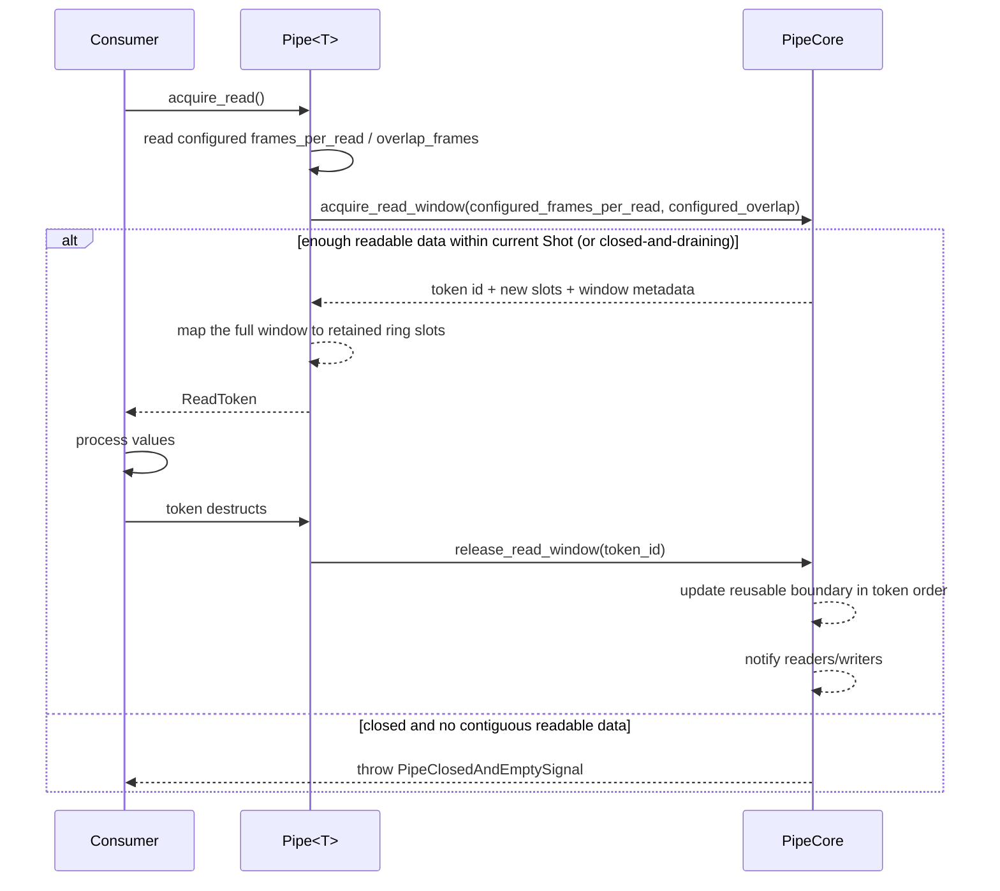

# Pipe Read Path Sequence

This page describes the read-side sequence, including overlapping read windows.

## Sequence Diagram

## Overlap Rules

- `overlap_frames` must be smaller than `frames_per_read`.
- `acquire_read()` always uses the configured consumer window.
- The `overlap_frames` prefix refers to slots in the previous window that remain in the
  ring buffer; no payload snapshot is made.
- Read acquisition reserves successive windows in order. Active tokens pin
  their slots until release, even if processing completes out of order.
- Overlap is constrained to the same Shot and never crosses a Shot boundary.

## Shot Rules

- Read windows are clipped to the nearest committed ShotEnd.
- `ReadToken` exposes `frame_count()`, `overlap_frames()`, `is_shot_start()`, and
  `is_shot_end()`.
- Consumers can use Shot flags to trigger end-of-shot flushing logic.

## Notes

- Read visibility is controlled by contiguous committed write order, not by isolated later publishes.
- Active-window slots remain pinned until token destruction, and the trailing
  configured overlap_frames remains pinned for the next acquisition.
- If the pipe faulted because of an earlier unpublished write token, readers can only drain the already visible prefix, then receive `PipeClosedAndEmptySignal`.
- Core remains type-agnostic; `Pipe<T>` maps each window position directly to
  its ring-buffer slot.
